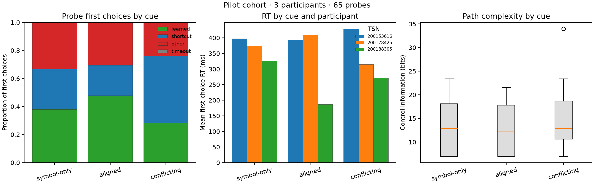
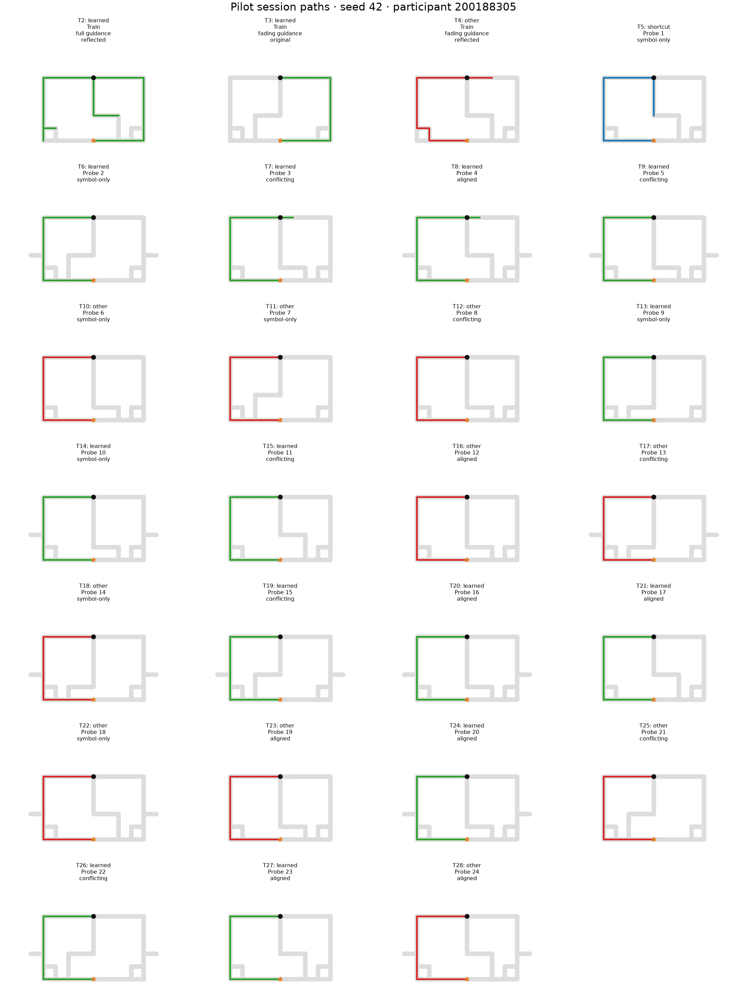
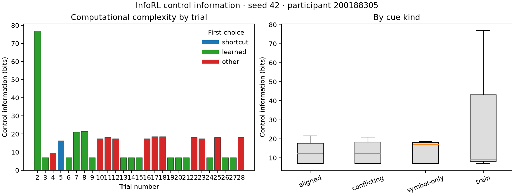
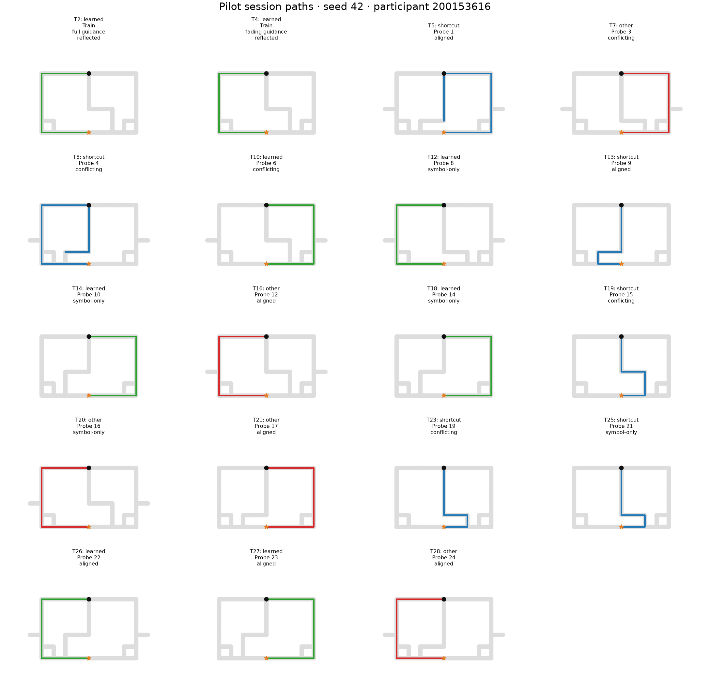
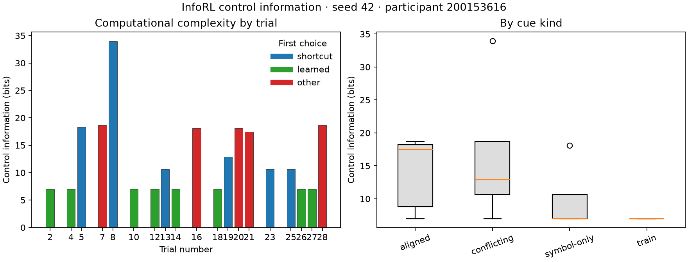
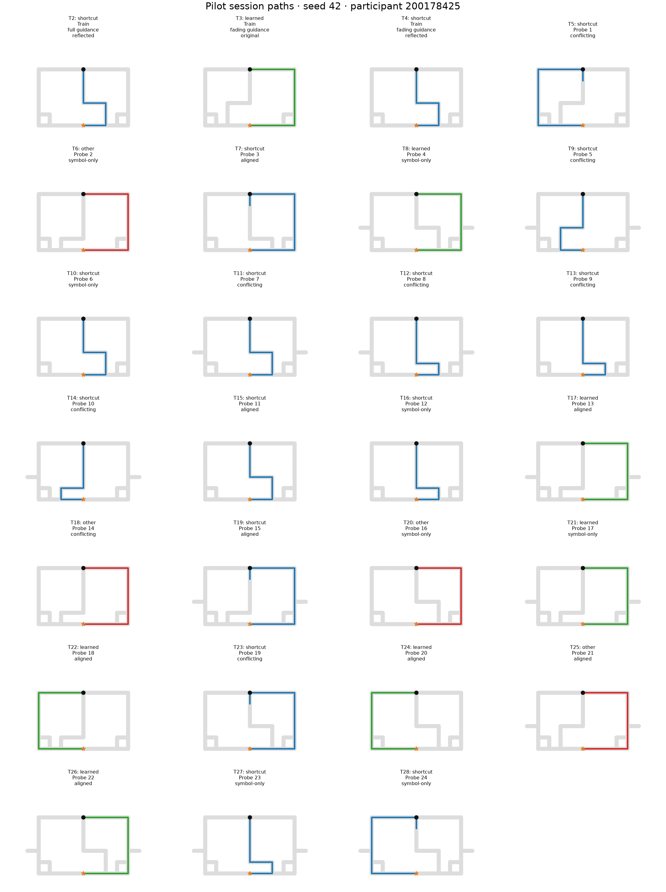
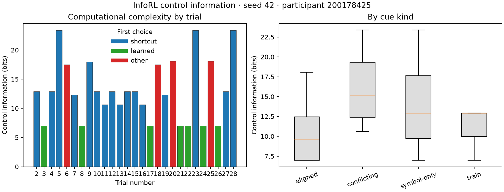

# Initial pilot results

**Source:** Neon `pilot_sessions` exports under `Data/maze-pilot-log-42-*.json`  
**Seed:** `42` · **Phase:** pilot · **Completed sessions:** 3  
**Date pulled:** 2026-11-24

Descriptive only. No inferential tests. Live playable export timed every first
move (800 ms). Participant TSN is stored raw; schedules use `TSN % 16`.

## Study question (brief)

Does time pressure increase learned-route first choices more when the beacon is
informative (aligned with the learned side) than when it is uninformative?

These sessions are the cue-probe pilot (symbol-only / aligned / conflicting),
used to exercise landmarks and calibrate RTs before the full test design.

## Cohort at a glance

| TSN | Probes | Learned | Shortcut | Other | Timeout | Calibrated deadline | Mean path control info\* |
| --- | ---: | ---: | ---: | ---: | ---: | ---: | ---: |
| 200188305 | 24 | 13 | 1 | 10 | 0 | 400 ms | 15.13 bits |
| 200153616 | 24 | 6 | 6 | 5 | 7 | 734 ms | 12.84 bits |
| 200178425 | 24 | 6 | 14 | 4 | 0 | 442 ms | 13.15 bits |
| **All** | **72** | **25** | **21** | **19** | **7** | — | — |

\*Control information is scored only on trials with a logged path of length ≥ 2
(timeouts with no moves are excluded from the complexity tables).



*Figure 1. Probe first-choice mix, mean RT by participant, and path control
information by cue kind across the three completed Neon sessions.*

### Probe first choices by cue (all logged probes)

| Kind | N | Learned | Shortcut | Other | Timeout | Mean RT |
| --- | ---: | ---: | ---: | ---: | ---: | ---: |
| Symbol-only | 24 | 8 | 6 | 7 | 3 | 416 ms |
| Aligned | 24 | 11 | 5 | 7 | 1 | 347 ms |
| Conflicting | 24 | 6 | 10 | 5 | 3 | 385 ms |

Aligned probes show the highest learned rate (11/24). Conflicting probes show
the highest shortcut rate (10/24). Symbol-only sits between them. Individual
strategies differ sharply (see per-participant notes).

## Per participant

### TSN 200188305

Fast, learned-leaning. Almost no shortcuts on probes (1/24). Calibrated deadline
400 ms. Mean control information 15.13 bits on scored paths (longer / more
exploratory trajectories when not on the learned route).

| Kind | Learned / N | Mean RT |
| --- | ---: | ---: |
| Symbol-only | 3 / 8 | 325 ms |
| Aligned | 5 / 8 | 187 ms |
| Conflicting | 5 / 8 | 272 ms |



*Figure 2. Paths for TSN 200188305 (blue shortcut, green learned, red other).*



*Figure 3. Control information by trial for TSN 200188305.*

### TSN 200153616

More timeouts (7 probe timeouts) and a slower calibrated deadline (734 ms).
Mixed first choices; conflicting probes mostly shortcut or timeout.

| Kind | Learned / N | Mean RT |
| --- | ---: | ---: |
| Symbol-only | 3 / 8 | 549 ms |
| Aligned | 2 / 8 | 444 ms |
| Conflicting | 1 / 8 | 568 ms |



*Figure 4. Paths for TSN 200153616.*



*Figure 5. Control information by trial for TSN 200153616.*

### TSN 200178425

Shortcut-dominant, especially under conflicting beacons (7/8 shortcuts). No
probe timeouts. Calibrated deadline 442 ms.

| Kind | Learned / N | Mean RT |
| --- | ---: | ---: |
| Symbol-only | 2 / 8 | 374 ms |
| Aligned | 4 / 8 | 410 ms |
| Conflicting | 0 / 8 | 315 ms |



*Figure 6. Paths for TSN 200178425.*



*Figure 7. Control information by trial for TSN 200178425.*

## Computational complexity (control information)

Following Lancia et al. (2023), **computational complexity** here is empirical
**control information**: bits a path costs relative to a default policy that
prefers the trained learned route.

\[
\hat{I} = \sum_t -\log_2 \rho(a_t \mid s_t)
\]

Code: [`Analysis/computational_complexity.py`](../Analysis/computational_complexity.py).
Cohort table: [`pilot-cohort-trials.csv`](pilot-cohort-trials.csv).
Per-session CSVs: `computational-complexity-42-<TSN>.csv`.

### Pattern notes

- Aligned cues associate with more learned first choices in the pooled sample.
- Conflicting cues associate with more shortcuts (clearest in TSN 200178425).
- Learned first choices that stay on route keep control information low;
  shortcut and exploratory paths cost more bits.
- Between-participant strategy variance is large at N = 3; treat cue contrasts
  as exploratory calibration, not study conclusions.

## What is not estimated yet

**Policy complexity** \(I(S;A)\) (Lai & Gershman, 2024) needs many repeated
state–action visits per condition. Three pilot sessions remain sparse for a
stable mutual-information estimate, so that metric is omitted.

## Reproduce

```sh
# Pull completed (+ optional --all) sessions from Neon
node scripts/export-sessions.mjs --all

# Per-session complexity + path plots
uv run --with matplotlib python Analysis/computational_complexity.py --log Data/maze-pilot-log-42-200188305.json
uv run --with matplotlib python Data/_plot_trials.py --log Data/maze-pilot-log-42-200188305.json

# Cohort aggregate
uv run --with matplotlib python Analysis/pilot_cohort.py
```

Outputs land in `Results/` (and copies under `media/`).

## References

- Lancia, G. L., Eluchans, M., D’Alessandro, M., Spiers, H. J., & Pezzulo, G. (2023). Humans account for cognitive costs when finding shortcuts: An information-theoretic analysis of navigation. *PLOS Computational Biology*.
- Lai, L., & Gershman, S. J. (2024). Human decision making balances reward maximization and policy compression. *PLOS Computational Biology*.
