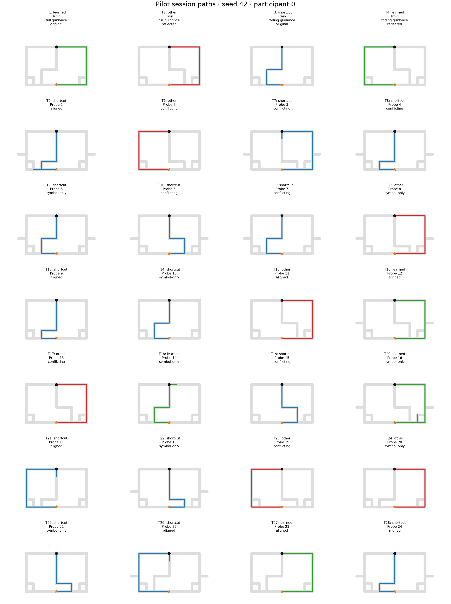
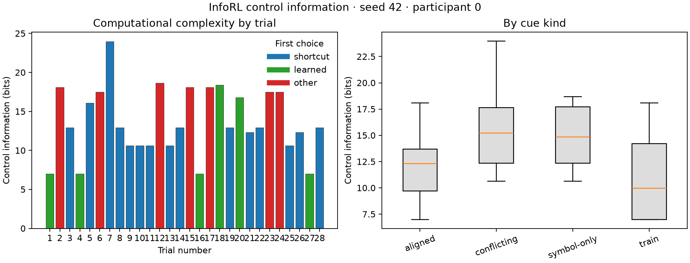

# Initial pilot results

**Session:** seed `42`, participant `0`, pilot phase  
**Date generated from log:** `Data/maze-pilot-log-42-0.json`  
**N trials:** 28 final attempts (4 train + 24 cue probes; one training restart dropped)

This note summarizes one self-pilot of the reflected-maze task. It is descriptive only: one participant, no inferential tests. Playable export timed every first move (800 ms).

## Study question (brief)

Does time pressure increase learned-route first choices more when the beacon is informative (aligned with the learned side) than when it is uninformative?

This pilot session is the cue-probe schedule (symbol-only / aligned / conflicting), used to exercise landmarks and calibrate RTs before the full test factor crossed design.

## Session summary

| Measure | Value |
| --- | --- |
| First choices | shortcut 15 · other 7 · learned 6 |
| Mean / median first-choice RT | 420 ms / 444 ms |
| Mean / median path steps | 11.7 / 13 |
| Mean / median control information | 13.7 bits / 12.9 bits |

### First choice by cue kind

| Kind | Learned / N | Mean first-choice RT |
| --- | ---: | ---: |
| Train | 2 / 4 | 526 ms |
| Symbol-only | 2 / 8 | 402 ms |
| Aligned | 2 / 8 | 414 ms |
| Conflicting | 0 / 8 | 389 ms |

Shortcut still dominated. Conflicting probes had no learned first choices in this run.

## Path trajectories

Figure 1 shows the taken path on each trial’s maze geometry. Blue = shortcut first choice, green = learned, red = other. Start is the filled marker; goal is the star.



*Figure 1. Paths for all 28 scored pilot trials.*

## Computational complexity (control information)

Following Lancia et al. (2023), **computational complexity** here is empirical **control information**: how many bits a path costs relative to a default policy that prefers the trained learned route.

For a deterministic logged path:

\[
\hat{I} = \sum_t -\log_2 \rho(a_t \mid s_t)
\]

where \(\rho\) puts most mass on the next learned-route step when the agent is on that route (else uniform over legal moves). Code: [`Analysis/computational_complexity.py`](../Analysis/computational_complexity.py). Per-trial table: [`computational-complexity-42-0.csv`](computational-complexity-42-0.csv).



*Figure 2. Left: control information (bits) by trial, colored by first choice. Right: distribution by cue kind (all first moves were timed in this export).*

### Per-trial values

| Trial | Kind | First choice | RT (ms) | Steps | Control info (bits) | Default-follow rate |
| ---: | --- | --- | ---: | ---: | ---: | ---: |
| 1 | train | learned | 459 | 13 | 6.99 | 0.92 |
| 2 | train | other | 542 | 13 | 18.08 | 0.31 |
| 3 | train | shortcut | 589 | 9 | 12.91 | 0.22 |
| 4 | train | learned | 513 | 13 | 6.99 | 0.92 |
| 5 | aligned | shortcut | 390 | 11 | 16.08 | 0.27 |
| 6 | conflicting | other | 617 | 13 | 17.49 | 0.31 |
| 7 | conflicting | shortcut | 139 | 15 | 23.98 | 0.33 |
| 8 | conflicting | shortcut | 533 | 9 | 12.91 | 0.22 |
| 9 | symbol-only | shortcut | 470 | 9 | 10.63 | 0.44 |
| 10 | conflicting | shortcut | 185 | 9 | 10.63 | 0.33 |
| 11 | conflicting | shortcut | 186 | 9 | 10.63 | 0.44 |
| 12 | symbol-only | other | 192 | 13 | 18.66 | 0.31 |
| 13 | aligned | shortcut | 139 | 9 | 10.63 | 0.44 |
| 14 | symbol-only | shortcut | 347 | 9 | 12.91 | 0.22 |
| 15 | aligned | other | 412 | 13 | 18.08 | 0.31 |
| 16 | aligned | learned | 543 | 13 | 6.99 | 0.92 |
| 17 | conflicting | other | 462 | 13 | 18.08 | 0.31 |
| 18 | symbol-only | learned | 261 | 13 | 18.38 | 0.38 |
| 19 | conflicting | shortcut | 421 | 9 | 12.91 | 0.33 |
| 20 | symbol-only | learned | 572 | 17 | 16.79 | 0.76 |
| 21 | aligned | shortcut | 366 | 15 | 12.32 | 0.87 |
| 22 | symbol-only | shortcut | 430 | 9 | 12.91 | 0.33 |
| 23 | conflicting | other | 572 | 13 | 17.49 | 0.31 |
| 24 | symbol-only | other | 421 | 13 | 17.49 | 0.31 |
| 25 | symbol-only | shortcut | 526 | 9 | 10.63 | 0.33 |
| 26 | aligned | shortcut | 406 | 15 | 12.32 | 0.87 |
| 27 | aligned | learned | 482 | 13 | 6.99 | 0.92 |
| 28 | aligned | shortcut | 574 | 9 | 12.91 | 0.22 |

### Pattern notes

- Learned first choices keep control information low when the path stays on route (~7 bits on several trials).
- Shortcut and exploratory paths cost more bits; the highest costs include wandering / backtracking.
- Conflicting beacons never produced a learned first choice in this single pilot.

## What is not estimated yet

**Policy complexity** \(I(S;A)\) (Lai & Gershman, 2024) — mutual information between states and actions — needs many repeated visits per state within a condition. One pilot session is still sparse for a stable Hutter / Dirichlet MI estimate, so that metric is omitted.

## Reproduce

```sh
uv run --with matplotlib python Analysis/computational_complexity.py
uv run --with matplotlib python Data/_plot_trials.py
```

Inputs: `Data/maze-pilot-log-42-0.json` (and matching move CSV).  
Outputs: `Results/computational-complexity-42-0.csv`, plots under `media/` (copied into `Results/` for this note).

## References

- Lancia, G. L., Eluchans, M., D’Alessandro, M., Spiers, H. J., & Pezzulo, G. (2023). Humans account for cognitive costs when finding shortcuts: An information-theoretic analysis of navigation. *PLOS Computational Biology*.
- Lai, L., & Gershman, S. J. (2024). Human decision making balances reward maximization and policy compression. *PLOS Computational Biology*.
